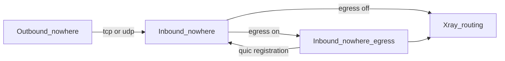

# Nowhere

Nowhere is a proxy protocol in this tree. TLS 1.3 is performed by the protocol itself. Do not wrap it in Xray `tls`, `reality`, WebSocket, or gRPC.

| Role | Protocol | Page |
| --- | --- | --- |
| Portal | inbound `nowhere` | [Inbound](configuration/inbound/nowhere.md) |
| Client | outbound `nowhere` | [Outbound](configuration/outbound/nowhere.md) |
| Exit bridge | inbound `nowhere-egress` | [Egress](configuration/inbound/nowhere-egress.md) |

`alpn` selects the stack, on both client and server. Omitted or `"nw3"` is Nowhere 3 (`nw3`), the default. `"nw2"`, or any other single value, is the legacy Nowhere 2 stack (`nw2`). The two stacks share no handshake. Nowhere 3 fixes ALPN to `nw3`; Nowhere 2 negotiates the configured value. The single Nowhere 3 transport is selected by `net`: `tcp` (TLS over TCP) or `udp` (QUIC).

中文：[README.zh.md](README.zh.md)。
