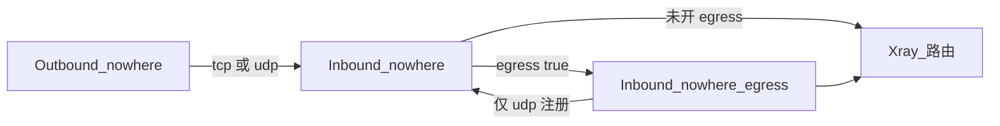

# Nowhere

Nowhere 是本仓库中的代理协议。TLS 1.3 由协议自己完成，不要再套 Xray 的 `tls`、`reality`、WebSocket 或 gRPC。

| 角色 | 协议名 | 文档 |
| --- | --- | --- |
| Portal | 入站 `nowhere` | [入站](configuration/inbound/nowhere.zh.md) |
| 客户端 | 出站 `nowhere` | [出站](configuration/outbound/nowhere.zh.md) |
| 出口桥 | 入站 `nowhere-egress` | [Egress](configuration/inbound/nowhere-egress.zh.md) |

`alpn` 选择协议栈，客户端与服务端规则一致。省略或 `"nw3"` 是 Nowhere 3（`nw3`），即默认栈。`"nw2"` 或其它任意单个值是遗留的 Nowhere 2 栈（`nw2`）。两套协议栈没有共同握手。Nowhere 3 的 ALPN 固定为 `nw3`；Nowhere 2 协商配置的值。Nowhere 3 的单一传输由 `net` 选择：`tcp`（TLS over TCP）或 `udp`（QUIC）。

English: [README.md](README.md).
